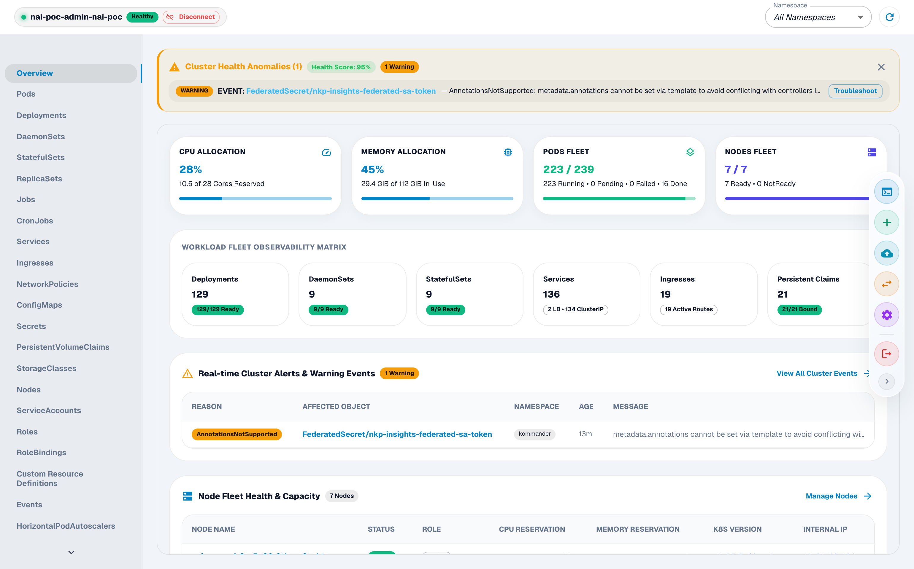
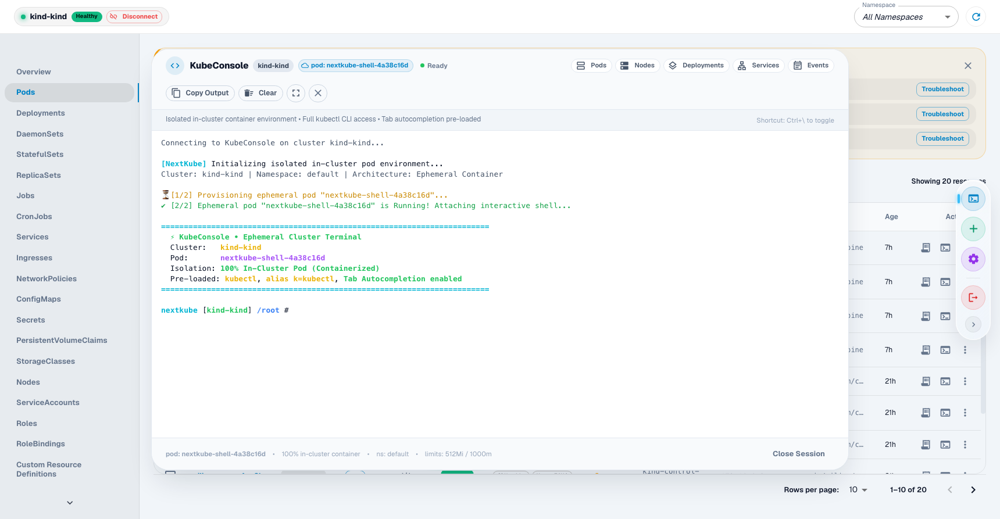
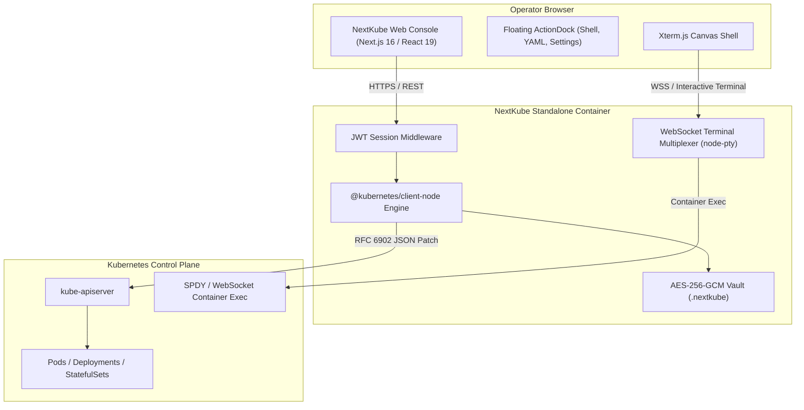

# NextKube ☸️🚀

> **High-Performance Standalone Kubernetes Cluster Operations & Management Console**  
> *Built with Next.js 16 (App Router), React 19, TypeScript, and Material-UI v9.*

[](https://github.com/su-mangale/NextKube/actions/workflows/build-nextkube.yml)
[](https://github.com/su-mangale/NextKube/pkgs/container/nextkube)
[](https://nextjs.org/)
[](https://react.dev/)
[](https://kubernetes.io/)
[](LICENSE)

---

## 📖 What is NextKube?

**NextKube** is an operator-first, modern web console designed to make day-to-day Kubernetes operations fast, visual, and secure. Unlike bloated legacy dashboards that require heavy in-cluster agents and complex ingress setups, NextKube operates as a **zero-dependency standalone engine**:
- It connects directly to your Kubernetes API servers (Kind, Minikube, or cloud-hosted EKS/GKE/AKS).
- Provides live workload telemetry, crash anomaly detection, and interactive container terminal execution right in your browser.
- Encrypts cluster access credentials at rest with **AES-256-GCM**, safeguarding your clusters.

---

## 📸 Visual Showcase

### 1. Cluster Observability & Workload Matrix Dashboard
Real-time visibility into CPU and Memory capacity allocation, node fleet readiness, workload health breakdown across Deployments, DaemonSets, StatefulSets, Services, and live warning event streams:


### 2. Workload Management & Direct Row Actions
Seamless pod inspection with inline action buttons for live logs, interactive terminal exec, and pod lifecycle restarts:


### 3. Real-Time Pod & Workload Logs Streaming
Multi-container log streaming with historical timeframe filters, local browser vs. UTC timezone toggles, live regex search, and instant clipboard export:


### 4. Interactive In-Pod Container Terminal (Exec Shell)
Direct WebSocket terminal execution into any container with multi-session tabs, full-screen mode, and responsive cursor resizing:


### 5. KubeConsole — Persistent In-Cluster Terminal
Dedicated, persistent in-cluster `kubectl` terminal with background session preservation (minimize & restore), tab auto-completion, quick resource query presets (`Pods`, `Nodes`, `Deployments`, `Services`, `Events`), and instant connection:


### 6. Deployments & Workload Scaling
Inspect replica readiness across your clusters with atomic replica scaling and rolling update controls:


### 7. Interactive Replica Scaling Slider
Scale Deployments, StatefulSets, and ReplicaSets with RFC 6902 JSON patch guarantees:


### 8. In-Browser YAML Manifest IDE
Edit, validate, and apply Kubernetes YAML and JSON manifests directly from the floating dock:


### 9. Liquid Glassmorphic ActionDock & Customizable Shortcuts
Persistent theme toggling (Dark & Light modes), multi-session window management, cluster switching, and customizable keyboard shortcuts:


### 10. Secure Operator Authentication Portal
Enterprise login protected by signed JWT session tokens:


### 11. Interactive Visual Topology & Dependency Graph ("Kubernetes Mind Map")
End-to-end visual dependency and live traffic map connecting Ingresses $\to$ Services $\to$ Workloads $\to$ Pods $\to$ Nodes & Storage:
- 60FPS fluid canvas with pan, zoom, auto-fit, and minimap radar.
- Flowing animated traffic particles on active routes.
- Pod replica grouping to eliminate clutter in large deployments.
- Node Inspector with 1-click Logs, Exec Shell, YAML editor, and scale/restart controls.
- Accessible via shortcut (`Alt+T`), the ActionDock, and the Overview Observability matrix.

### 12. AI-Powered Root-Cause Analysis (RCA) Engine
1-click SRE diagnosis for failing or crashing pods (`CrashLoopBackOff`, `OOMKilled`, `ImagePullBackOff`, `Pending`):
- Correlates termination exit codes, Kubernetes warning events, and container log crash dumps.
- Identifies root cause and generates concrete, executable YAML remediation patches (e.g. Memory limit bumps, command fixes).
- 1-click **"Apply Remediation Patch"** directly into the cluster with automatic audit trail logging.

### 13. Universal Command Palette Omnibar (`Ctrl+K` / `Cmd+K`)
Sub-50ms keyboard-driven command center:
- Fast fuzzy search across connected clusters, namespaces, workloads, and system commands.
- Switch clusters, change namespaces, toggle visual topology, or launch KubeConsole without touching the mouse.
- Integrated into the ActionDock, the search bar, and accessible via customizable shortcuts.

### 14. Visual Helm App Store & Package Hub
Comprehensive cloud-native app catalog (Ingress NGINX, Cert-Manager, Prometheus Stack, Redis, Argo CD, Ollama):
- Interactive visual forms mode alongside raw YAML editor for custom `values.yaml`.
- Revision histories, atomic upgrades, and 1-click rollbacks.
- Instant 1-click deployment with namespace selection and real-time validation.

### 15. In-Browser Port-Forwarding Manager & Microservice Tunnel
Direct TCP & HTTP forwarding into private pods and services without local CLI setup:
- Expose internal Redis caches, PostgreSQL databases, and microservices directly onto host ports (`localhost:<port>`).
- Live telemetry for active connections, bytes transferred, and tunnel state.
- 1-click **"Open Browser"** to launch internal web dashboards in new tabs, copy local URLs, or copy native `kubectl` commands.
- Accessible via shortcut (`Alt+P`), Pod/Service row actions, Command Palette, and ActionDock.

### 16. Visual YAML Diff & Historical Change Timeline ("GitOps Time Machine")
Full visual diffing and revision timeline across workload rollouts:
- **Interactive Revision Timeline**: Step backward and forward through Deployment, StatefulSet, and DaemonSet revisions with human-readable timestamps and change causes.
- **Split Side-by-Side & Unified Views**: Color-coded red/green diff view with line numbers and syntax highlighting.
- **Sanitize K8s Metadata**: 1-click toggle to strip transient metadata noise (`managedFields`, `resourceVersion`, timestamps) to reveal semantic configuration changes.
- **1-Click Rollback**: Revert workloads to any historical revision with progressive zero-downtime rolling restart.
- **Unified Patch Export**: Copy or download standard `.patch` files directly from the browser.

### 17. ConfigMap & Secret Drift Detector
Proactive discovery and remediation of pods running stale configuration:
- Scans all workloads and compares ConfigMap/Secret update timestamps against running pod initialization times.
- Identifies exact stale pods running outdated configurations after ConfigMaps or Secrets were updated.
- 1-click **"Zero-Downtime Rolling Sync"** to restart pods and mount the latest configuration without downtime.
- Accessible via shortcut (`Alt+C`), the left sidebar, Command Palette, and ActionDock with a live drift warning counter badge.

---

## 🏗️ How NextKube Works

NextKube combines a server-rendered Next.js frontend with an intelligent backend proxy that interfaces directly with your Kubernetes API servers and container runtimes.



---

## 📚 Detailed Documentation

Explore dedicated, in-depth documentation in the [`docs/`](docs/) directory:

| Section | Document | Description |
|---|---|---|
| **Architecture** | [docs/ARCHITECTURE.md](docs/ARCHITECTURE.md) | High-level system design, data flow diagrams, request lifecycles, and technical decisions. |
| **Features** | [docs/FEATURES.md](docs/FEATURES.md) | Comprehensive walkthrough of all 17+ resource types, logs streaming, and workload controls. |
| **Getting Started** | [docs/GETTING_STARTED.md](docs/GETTING_STARTED.md) | Step-by-step installation, local development guide, environment variables, and Kind/Minikube setup. |
| **Docker & Deployment** | [docs/DOCKER_AND_DEPLOYMENT.md](docs/DOCKER_AND_DEPLOYMENT.md) | Multi-stage Docker builds, GitHub Actions CI/CD workflows, FluxCD GitOps tagging, and K8s manifests. |
| **Security & RBAC** | [docs/SECURITY_AND_RBAC.md](docs/SECURITY_AND_RBAC.md) | AES-256-GCM encryption, JWT sessions, role privileges, and automated audit trails. |

---

## ⚡ Quick Start

### 1. Run with Node.js
```bash
# Clone the repository
git clone https://github.com/su-mangale/NextKube.git
cd NextKube

# Install dependencies
npm install

# Start development server
npm run dev
```

### 2. Run with Docker
```bash
# Run latest pre-built container from GitHub Container Registry
docker run -d --name nextkube \
  -p 3000:3000 \
  -v nextkube-vault:/app/.nextkube \
  -e NEXTKUBE_AUTH_SECRET="$(openssl rand -hex 16)" \
  -e NEXTKUBE_ENCRYPTION_KEY="$(openssl rand -hex 16)" \
  ghcr.io/su-mangale/nextkube:latest
```

> [!IMPORTANT]
> **Why are `NEXTKUBE_AUTH_SECRET` and `NEXTKUBE_ENCRYPTION_KEY` needed on Docker?**
> - **`NEXTKUBE_AUTH_SECRET`**: Signs and verifies HMAC-SHA256 operator JWT session cookies (`nextkube_session`). Setting a unique key prevents forged session tokens and keeps operators logged in across container restarts.
> - **`NEXTKUBE_ENCRYPTION_KEY`**: Master key for AES-256-GCM encryption of attached cluster credentials (kubeconfigs and bearer tokens) stored in `.nextkube/clusters.json`. A persistent key ensures the container can decrypt your saved cluster credentials across updates and volume mounts.
> - **Production Hardening**: Overriding the development fallback secrets ensures that no public default keys from the open-source repository can decrypt your vault or forge admin sessions.

Open [http://localhost:3000](http://localhost:3000) and log in with operator username `admin`.

---

## 🛠️ Tech Stack

- **Framework**: [Next.js 16](https://nextjs.org/) (Turbopack, App Router, Standalone output)
- **Library**: [React 19](https://react.dev/)
- **UI Components**: [Material-UI v9 (MUI)](https://mui.com/) & [Emotion](https://emotion.sh/)
- **State & Data Sync**: [TanStack React Query v5](https://tanstack.com/query/latest)
- **Terminal Emulator**: [Xterm.js v6](https://xtermjs.org/) with `@xterm/addon-fit`
- **Native Terminal PTY**: [node-pty](https://github.com/microsoft/node-pty)
- **Kubernetes Client**: [@kubernetes/client-node v2](https://github.com/kubernetes-client/javascript)
- **Security & Crypto**: [jose (JWT)](https://github.com/panva/jose) & Node crypto (AES-256-GCM)

---

## 📄 License

This project is licensed under the MIT License - see the [LICENSE](LICENSE) file for details.
