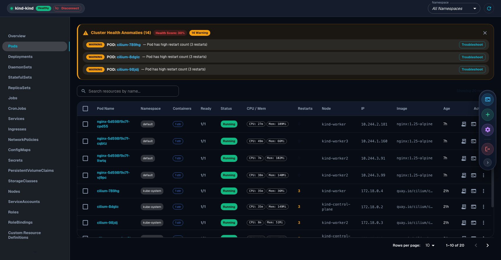
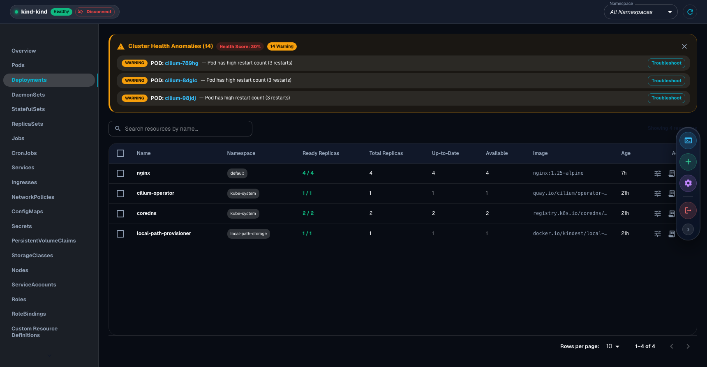
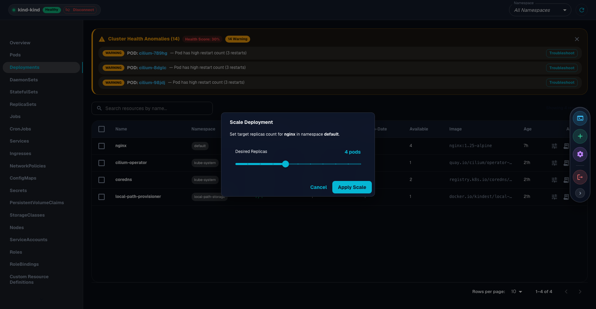
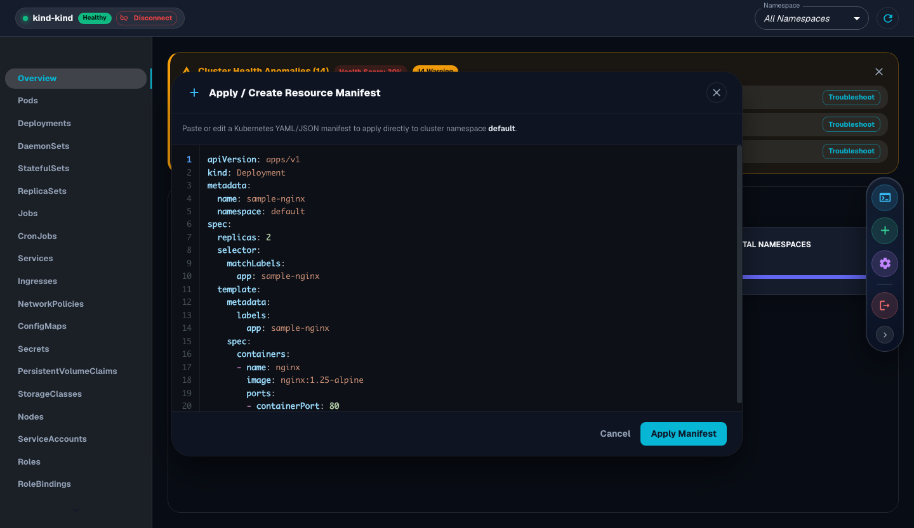
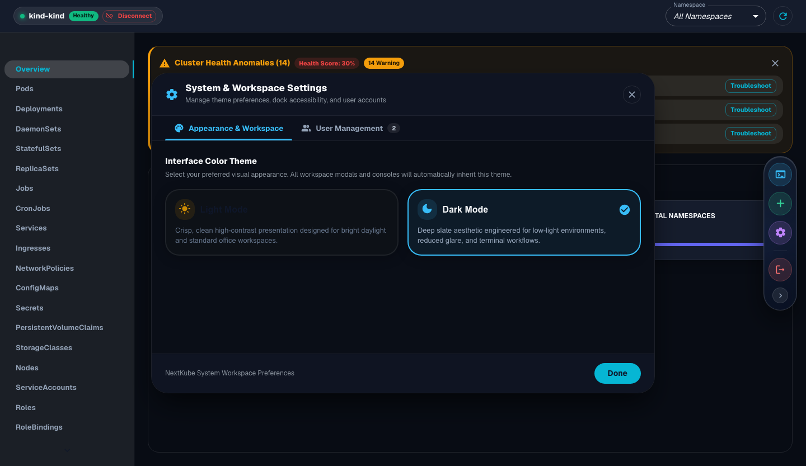
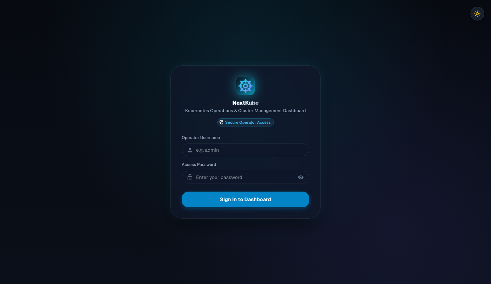
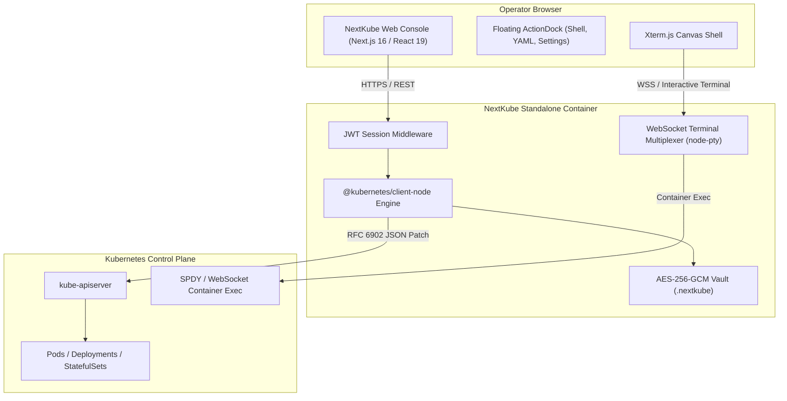

# NextKube ☸️🚀

> **High-Performance Standalone Kubernetes Cluster Operations & Management Console**  
> *Built with Next.js 16 (App Router), React 19, TypeScript, and Material-UI v9.*

[](https://github.com/su-mangale/NextKube/actions/workflows/build-nextkube.yml)
[](https://github.com/su-mangale/NextKube/pkgs/container/nextkube)
[](https://nextjs.org/)
[](https://react.dev/)
[](https://kubernetes.io/)
[](LICENSE)

---

## 📖 What is NextKube?

**NextKube** is an operator-first, modern web console designed to make day-to-day Kubernetes operations fast, visual, and secure. Unlike bloated legacy dashboards that require heavy in-cluster agents and complex ingress setups, NextKube operates as a **zero-dependency standalone engine**:
- It connects directly to your Kubernetes API servers (Kind, Minikube, or cloud-hosted EKS/GKE/AKS).
- Provides live workload telemetry, crash anomaly detection, and interactive container terminal execution right in your browser.
- Encrypts cluster access credentials at rest with **AES-256-GCM**, safeguarding your clusters.

---

## 📸 Visual Showcase

### 1. Cluster Operations & Anomaly Detection Dashboard
Real-time visibility into pod readiness, deployment states, node availability, and automated crash-loop anomaly detection:


### 2. Workload Management & Direct Row Actions
Seamless pod inspection with inline action buttons for live logs, interactive terminal exec, and pod lifecycle restarts:


### 3. Deployments & Workload Scaling
Inspect replica readiness across your clusters with atomic replica scaling and rolling update controls:


### 4. Interactive Replica Scaling Slider
Scale Deployments, StatefulSets, and ReplicaSets with RFC 6902 JSON patch guarantees:


### 5. In-Browser YAML Manifest IDE
Edit, validate, and apply Kubernetes YAML and JSON manifests directly from the floating dock:


### 6. Liquid Glassmorphic ActionDock & System Preferences
Persistent theme toggling (Dark & Light modes) and multi-session window management:


### 7. Secure Operator Authentication Portal
Enterprise login protected by signed JWT session tokens:


---

## 🏗️ How NextKube Works

NextKube combines a server-rendered Next.js frontend with an intelligent backend proxy that interfaces directly with your Kubernetes API servers and container runtimes.



---

## 📚 Detailed Documentation

Explore dedicated, in-depth documentation in the [`docs/`](docs/) directory:

| Section | Document | Description |
|---|---|---|
| **Architecture** | [docs/ARCHITECTURE.md](docs/ARCHITECTURE.md) | High-level system design, data flow diagrams, request lifecycles, and technical decisions. |
| **Features** | [docs/FEATURES.md](docs/FEATURES.md) | Comprehensive walkthrough of all 17+ resource types, logs streaming, and workload controls. |
| **Getting Started** | [docs/GETTING_STARTED.md](docs/GETTING_STARTED.md) | Step-by-step installation, local development guide, environment variables, and Kind/Minikube setup. |
| **Docker & Deployment** | [docs/DOCKER_AND_DEPLOYMENT.md](docs/DOCKER_AND_DEPLOYMENT.md) | Multi-stage Docker builds, GitHub Actions CI/CD workflows, FluxCD GitOps tagging, and K8s manifests. |
| **Security & RBAC** | [docs/SECURITY_AND_RBAC.md](docs/SECURITY_AND_RBAC.md) | AES-256-GCM encryption, JWT sessions, role privileges, and automated audit trails. |

---

## ⚡ Quick Start

### 1. Run with Node.js
```bash
# Clone the repository
git clone https://github.com/su-mangale/NextKube.git
cd NextKube

# Install dependencies
npm install

# Start development server
npm run dev
```

### 2. Run with Docker
```bash
# Run latest pre-built container from GitHub Container Registry
docker run -d --name nextkube \
  -p 3000:3000 \
  ghcr.io/su-mangale/nextkube:latest
```

Open [http://localhost:3000](http://localhost:3000) and log in with operator username `admin`.

---

## 🛠️ Tech Stack

- **Framework**: [Next.js 16](https://nextjs.org/) (Turbopack, App Router, Standalone output)
- **Library**: [React 19](https://react.dev/)
- **UI Components**: [Material-UI v9 (MUI)](https://mui.com/) & [Emotion](https://emotion.sh/)
- **State & Data Sync**: [TanStack React Query v5](https://tanstack.com/query/latest)
- **Terminal Emulator**: [Xterm.js v6](https://xtermjs.org/) with `@xterm/addon-fit`
- **Native Terminal PTY**: [node-pty](https://github.com/microsoft/node-pty)
- **Kubernetes Client**: [@kubernetes/client-node v2](https://github.com/kubernetes-client/javascript)
- **Security & Crypto**: [jose (JWT)](https://github.com/panva/jose) & Node crypto (AES-256-GCM)

---

## 📄 License

This project is licensed under the MIT License - see the [LICENSE](LICENSE) file for details.
