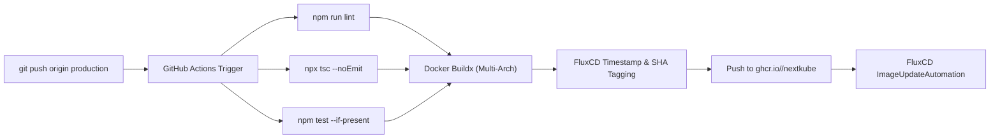

# Docker & CI/CD Deployment Guide

NextKube is designed from the ground up for containerized deployment, featuring a multi-stage Alpine Docker build and automated GitHub Actions CI/CD with GitOps FluxCD tagging.

---

## 🐳 Production Docker Build

The NextKube [Dockerfile](file:///Users/mangale/Downloads/github/NextKube/Dockerfile) leverages a 3-stage build to produce a compact, production-ready runner image:

1. **`base`**: Node 24 Alpine with `libc6-compat` for musl compatibility.
2. **`deps`**: Installs build essentials (`python3 make g++`) required for native `node-pty` compilation and runs `npm ci`.
3. **`builder`**: Compiles the Next.js standalone application with Turbopack and copies static assets.
4. **`runner`**: Minimal unprivileged runtime running as non-root `nextjs` user.

### Building Locally

```bash
docker build -t nextkube:latest .
```

### Running Locally

```bash
docker run -d --name nextkube \
  -p 3000:3000 \
  -v nextkube-vault:/app/.nextkube \
  -e NEXTKUBE_AUTH_SECRET="$(openssl rand -hex 16)" \
  -e NEXTKUBE_ENCRYPTION_KEY="$(openssl rand -hex 16)" \
  nextkube:latest
```

---

## 🔐 Environment Security Variables (Why They Are Needed on Docker)

When running NextKube in Docker, two environment variables are essential for security and state persistence:

| Variable | Cryptographic Purpose | Minimum Length | Default / Fallback |
|---|---|---|---|
| **`NEXTKUBE_AUTH_SECRET`** | Signs & verifies HMAC-SHA256 (`HS256`) operator session cookies (`nextkube_session`). | 32 characters | Hardcoded repo fallback string |
| **`NEXTKUBE_ENCRYPTION_KEY`** | Master key for **AES-256-GCM** encryption of cluster credentials (kubeconfig/tokens) in `.nextkube/clusters.json`. | 32 characters | Falls back to `NEXTKUBE_AUTH_SECRET` or repo default |

### Why They Are Critical on Docker

1. **State Persistence Across Container Lifecycles & Restarts**:
   - NextKube stores connected Kubernetes cluster credentials (raw kubeconfigs, Bearer tokens, CA certs) inside `.nextkube/clusters.json` on a persistent volume (`-v nextkube-vault:/app/.nextkube`).
   - Every credential is encrypted with **AES-256-GCM**.
   - If a container is recreated, restarted, or upgraded to a new image version, it **must be provided with the exact same `NEXTKUBE_ENCRYPTION_KEY`** to decrypt and connect to your attached clusters. If this key is missing or changes, the vault cannot decrypt your saved clusters (`Failed to decrypt cluster payload`).

2. **Preventing Exploitation of Public Open-Source Defaults**:
   - In local development, NextKube falls back to built-in development keys.
   - Because NextKube is open source, anyone on the network can see the repository's fallback strings. If you deploy a Docker container without overriding these variables:
     - An attacker could forge a JWT session cookie with `role: "admin"` and gain full control of your clusters.
     - An attacker with access to a backup or volume snapshot of `.nextkube/clusters.json` could decrypt all sensitive kubeconfigs and cluster tokens.

3. **Session Continuity Across Deployments**:
   - A consistent `NEXTKUBE_AUTH_SECRET` prevents active operators from having their session cookies invalidated and getting unexpectedly logged out every time the container restarts or scales.

### Docker Compose Example

```yaml
services:
  nextkube:
    image: ghcr.io/su-mangale/nextkube:latest
    container_name: nextkube
    restart: unless-stopped
    ports:
      - "3000:3000"
    volumes:
      - nextkube-vault:/app/.nextkube
    environment:
      - PORT=3000
      - HOSTNAME=0.0.0.0
      - NEXTKUBE_AUTH_SECRET=${NEXTKUBE_AUTH_SECRET}
      - NEXTKUBE_ENCRYPTION_KEY=${NEXTKUBE_ENCRYPTION_KEY}

volumes:
  nextkube-vault:
    driver: local
```

---

## 🚀 GitHub Actions Automated CI/CD Pipeline

The repository includes a reusable GitHub Actions workflow configured in [.github/workflows/build-nextkube.yml](file:///Users/mangale/Downloads/github/NextKube/.github/workflows/build-nextkube.yml) and [.github/workflows/_reusable-build.yml](file:///Users/mangale/Downloads/github/NextKube/.github/workflows/_reusable-build.yml).

### Workflow Triggers
- **Pushes to `production`**: Automatically initiates quality checks, multi-platform Docker compilation, and pushes images to GitHub Container Registry (`ghcr.io`).
- **Pushes to version tags (`v*`)**: Automatically builds and publishes release images.
- **Pull Requests targeting `production`**: Runs all quality gates and builds the container image to verify compilation without pushing.
- **Manual Trigger**: Can be manually initiated at any time via GitHub Actions `workflow_dispatch`.



### Image Tagging Format
Every successful production build publishes image tags formatted for automated GitOps reconcilers:
- **FluxCD Tag**: `<TIMESTAMP>-sha-<7-char-sha>` (e.g. `20261118T055304Z-sha-35ebb3b`)
- **Latest Tag**: `latest` (assigned automatically to the tip of `production`)
- **Semantic Tag**: Corresponds directly to git tags when tags are pushed (`v0.1.1`).

---

## ☸️ In-Cluster Kubernetes Deployment Manifest

To deploy NextKube inside your Kubernetes cluster:

```yaml
apiVersion: apps/v1
kind: Deployment
metadata:
  name: nextkube
  namespace: nextkube-system
  labels:
    app.kubernetes.io/name: nextkube
spec:
  replicas: 1
  selector:
    matchLabels:
      app.kubernetes.io/name: nextkube
  template:
    metadata:
      labels:
        app.kubernetes.io/name: nextkube
    spec:
      containers:
        - name: nextkube
          image: ghcr.io/su-mangale/nextkube:latest
          imagePullPolicy: IfNotPresent
          ports:
            - containerPort: 3000
              name: http
          env:
            - name: PORT
              value: "3000"
            - name: HOSTNAME
              value: "0.0.0.0"
            - name: NEXTKUBE_AUTH_SECRET
              valueFrom:
                secretKeyRef:
                  name: nextkube-secrets
                  key: auth-secret
            - name: NEXTKUBE_ENCRYPTION_KEY
              valueFrom:
                secretKeyRef:
                  name: nextkube-secrets
                  key: encryption-key
          resources:
            requests:
              cpu: 100m
              memory: 128Mi
            limits:
              cpu: 500m
              memory: 512Mi
---
apiVersion: v1
kind: Service
metadata:
  name: nextkube
  namespace: nextkube-system
spec:
  type: ClusterIP
  selector:
    app.kubernetes.io/name: nextkube
  ports:
    - name: http
      port: 80
      targetPort: 3000
```
