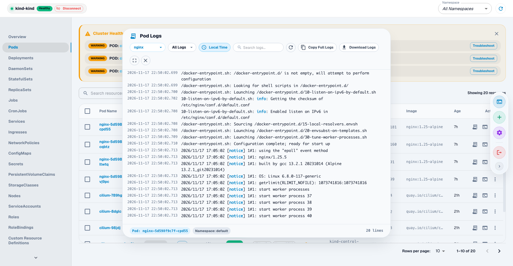
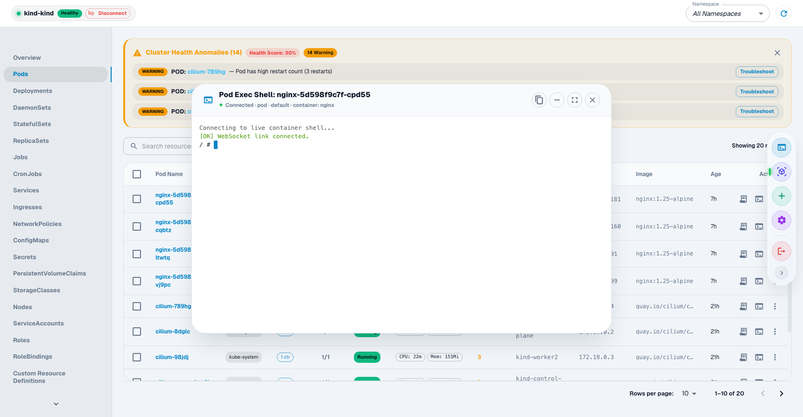
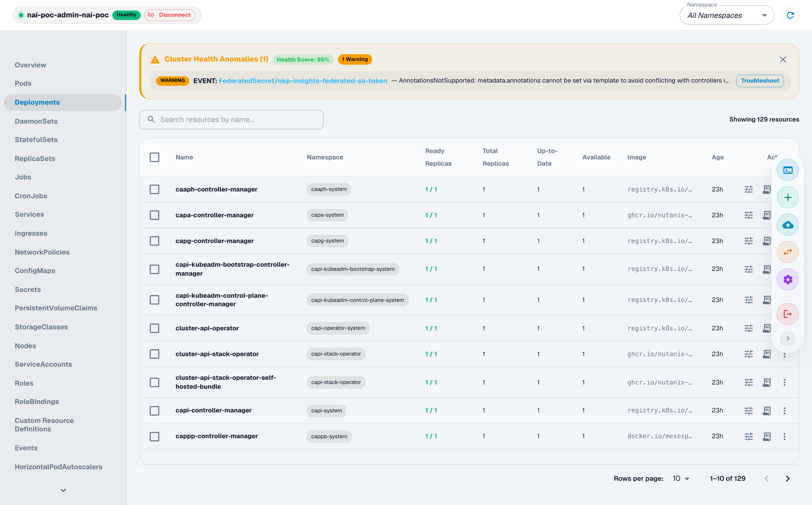
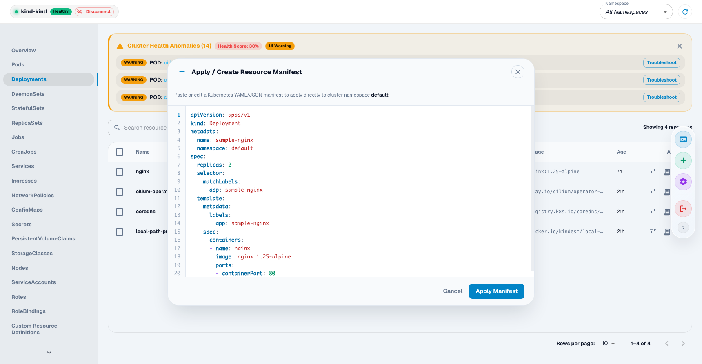

# NextKube Features & Operations Guide

NextKube equips operators and platform teams with a modern dashboard that replaces confusing CLI incantations with intuitive, visual cluster management.

---

## 🌟 Visual Feature Showcase

### 1. Cluster Observability & Workload Matrix

- **Resource Allocation Gauges**: Real-time CPU and Memory allocation cards with usage percentages and dynamic progress bars.
- **Workload Fleet Health Matrix**: Interactive breakdown of Deployments, DaemonSets, StatefulSets, Services, Ingresses, and PVCs with healthy-versus-total counts.
- **Real-Time Warning Alerts & Events Stream**: Highlights warning events, affected workloads, namespaces, and timestamps.
- **Node Fleet Health & Capacity Table**: Live node status, roles, CPU/Memory reservation, Kubernetes version, and internal IPs.

---

### 2. Pod Management & Row-Level Actions

- **Inline Pod Actions**: Direct action buttons on every pod row:
  - 📜 **View Logs**: Tail real-time stdout/stderr streams.
  - 💻 **Terminal Exec**: Open a live shell into any container in the pod.
  - 🔄 **Restart Pod**: Safely delete the pod to allow its controller to respawn a clean replacement.
  - 🗑️ **Delete**: Terminate unwanted or stuck pods.
- **Resource Search & Filtering**: Instant client-side search by pod name or namespace.

---

### 3. Real-Time Pod & Workload Logs Streaming

- **Live Stream Viewer**: Tail container logs with color-coded severity levels (`ERROR`, `WARN`, `INFO`).
- **Container Switching**: Seamlessly switch between multiple containers in a pod or across deployment replicas.
- **Timeframe & Mode Filters**: Filter logs by recency (`5m`, `15m`, `30m`, `1h`, `6h`, `24h`, or previous terminated container `pre`).
- **Timezone Adjustment**: One-click toggle between Local Browser Time and raw UTC pod timestamps.
- **In-Memory Search**: Filter lines dynamically with match count indicators.

---

### 4. Interactive In-Pod Terminal (Container Exec)

- **Direct Web Terminal**: In-browser interactive shell connected via WebSocket to the container's shell (`/bin/sh`, `/bin/bash`).
- **Multi-Session Management**: Run simultaneous terminal sessions to different pods/containers with minimize, restore, and tab cycling.
- **Draggable & Resizable Window**: Freeform cursor resizing and full-screen maximization.

---

### 5. KubeConsole — Persistent In-Cluster Shell

- **Instant Cluster CLI**: Persistent in-cluster pod architecture (`nextkube-shell`) for sub-second terminal connections without provisioning delays.
- **Background Session Preservation**: Minimize the window to keep the shell session, terminal buffer, and running commands alive in the background.
- **Fast Action Toolbar**: Pre-configured query buttons for instant access to `Pods`, `Nodes`, `Deployments`, `Services`, and `Events`.
- **Pre-loaded Tooling**: Comes equipped with `kubectl`, `alias k=kubectl`, and tab auto-completion out of the box.

---

### 6. Deployments & Workload Management

- **Workload Status**: Real-time breakdown of `Ready Replicas`, `Total Replicas`, `Up-to-Date`, and `Available` counts.
- **Quick Controls**:
  - Tune replicas directly with the inline scale tool.
  - View deployment logs across all backing replica pods.
  - Trigger rolling update restarts.

---

### 7. Interactive Replica Scaling

- **Atomic Scaling**: Scale Deployments, StatefulSets, and ReplicaSets with an intuitive slider control.
- **Zero Race Conditions**: Powered by RFC 6902 JSON Patch operations targeting the Kubernetes subresource scale API.
- **Instant Live Feedback**: Automatically refetches and synchronizes the UI the moment the API server accepts the mutation.

---

### 8. In-App YAML Manifest IDE

- **Apply & Create**: Paste or edit raw Kubernetes YAML/JSON manifests directly from the browser.
- **Syntax Highlighting & Formatting**: Integrated manifest editor with syntax highlighting and line numbering.
- **Direct Cluster Mutation**: Validates manifests against the target cluster schema and applies updates safely.

---

### 9. System Preferences & Customizable Shortcuts

- **Fluid Dark / Light Modes**: Switch between deep slate dark mode and clean daylight light mode with zero hydration flash.
- **Customizable Global Hotkeys**: Rebind shortcuts for KubeConsole, manifest editor, cluster switcher, and dock actions directly from the settings panel.
- **User Management**: Admin controls for managing operator credentials and roles.
- **Liquid Glassmorphic ActionDock**: Floating action dock provides quick access to shells, cluster switcher, manifest creation, settings, and session controls.

---

### 10. Secure Authentication Portal

- **JWT Session Protection**: High-security, encrypted session tokens stored in HTTP-only cookies.
- **Role-Based Access Control**: Pre-configured operator profiles (`admin`, `operator`, `viewer`) preventing unauthorized resource destruction.

---

### 11. Interactive Visual Topology & Dependency Graph ("Kubernetes Mind Map")
- **End-to-End Architecture Flow**: Renders live relationships from edge routing to physical compute:
  - $\text{Ingress / Gateway} \longrightarrow \text{Services} \longrightarrow \text{Workloads (Deployments / DaemonSets / StatefulSets)} \longrightarrow \text{Pods} \longrightarrow \text{Nodes \& Storage (PVCs)}$
- **Smooth 60FPS Pan & Zoom Canvas**: Drag-to-pan, wheel zoom, auto-fit to screen, and real-time minimap radar.
- **Animated Traffic Particles**: Active connections display flowing glowing particles with color-coded status rings (🟢 Healthy, 🟠 Degraded, 🔴 Error).
- **Replica Consolidation Toggle**: Combines replica pods into clean parent nodes (e.g., `web-service (5 Replicas)`) to eliminate visual clutter in large deployments, with click-to-expand inspector.
- **Interactive Inspector Drawer**: Click any node on the graph to inspect labels, container images, IP addresses, node placements, and trigger instant actions:
  - 📜 **View Logs** (Pods, Deployments, DaemonSets, StatefulSets)
  - 💻 **Open Shell (Exec)** (Pods)
  - 📄 **View / Edit YAML** (All resources)
  - ⚖️ **Scale Replicas** & 🔄 **Rollout Restart**
- **Action Dock & Global Shortcut**: Instantly accessible via `Alt+T`, the floating Action Dock, or the Overview Observability matrix.

---

### 15. AI-Powered Root-Cause Analysis (RCA) Engine
Automated SRE diagnostics for unhealthy workloads:
- **Crash Anomaly Triage**: Instantly detects and analyzes pods trapped in `CrashLoopBackOff`, `OOMKilled`, `ImagePullBackOff`, `CreateContainerConfigError`, and `Unschedulable/Pending`.
- **Telemetry Correlation**: Pulls the last termination exit code, matches recent warning events from `kube-events`, and extracts relevant failure log dumps in real-time.
- **Actionable Remediation**: Proposes actionable human-readable explanations alongside verified RFC 6902 / YAML patches.
- **1-Click Apply**: Directly applies the proposed fix to the parent workload with one click and audits the event.

---

### 16. Universal Command Palette Omnibar (`Ctrl+K` / `Cmd+K`)
Keyboard-driven omnibar designed for sub-50ms operations:
- **Instant Global Navigation**: Jump directly to any Kubernetes resource tab (Overview, Pods, Deployments, Services, ConfigMaps, Helm Releases, Topology).
- **Cluster & Namespace Switching**: Filter and jump between attached clusters or namespaces with zero mouse clicks.
- **Quick Command Shortcuts**: Direct execution for opening KubeConsole, applying manifests, triggering full-cluster sync, and opening settings.
- **Fuzzy Search & Keybindings**: Arrow key navigation, `Enter` to execute, and configurable shortcuts in Settings.

---

### 17. Visual Helm App Store & Package Hub
Enterprise-grade cloud-native application management:
- **Curated Catalog**: Built-in support for industry-standard charts (`ingress-nginx`, `cert-manager`, `kube-prometheus-stack`, `redis`, `argo-cd`, `ollama`).
- **Interactive Visual Config Mode**: Form-driven parameter configuration with real-time toggle switches, replica counts, and ingress hosts.
- **Raw YAML values.yaml Editor**: Direct in-browser YAML preview with syntax highlighting and instant sync with visual controls.
- **Release Lifecycle Management**: Inspect installed releases, app versions, revision counters, status indicators, and 1-click rollback or uninstallation.

---

### 18. Structured Hierarchical Sidebar Navigation & Footer Settings
Operator-first left sidebar replacing flat tabs with domain-driven collapsible groups:
- **Logical Domain Groups**:
  - ⚡ **Workloads**: `Deployments`, `Pods`, `StatefulSets`, `DaemonSets`, `ReplicaSets`, `Jobs`, `CronJobs`.
  - 🌐 **Networking**: `Services`, `Ingresses`, `Gateway API`, `Network Policies`.
  - 🗄️ **Config & Storage**: `ConfigMaps`, `Secrets`, `PVCs`, `Persistent Volumes`, `Storage Classes`.
  - 🏢 **Cluster & Access**: `Nodes`, `Service Accounts`, `Roles`, `Role Bindings`, `HPAs`, `CRDs`, `Events`.
- **Top Platform Anchors**: Direct access to `Overview` and `Topology Map`.
- **Ecosystem Tools**: Direct access to `Helm App Store` and `Audit Trail`.
- **Live Counter Badges**: Real-time workload & object count pills alongside every resource.
- **Auto-Expansion & Persistence**: Automatically expands the corresponding group when jumping to an object via Command Palette or URL, with group states remembered across browser sessions via `localStorage`.
- **Pinned Sidebar Footer**: Pinned **Settings** (`Alt+,`) and **Command Palette** launcher (`⌘K`) right at the bottom of the navigation bar, removing clutter from floating tools.

---

### 19. In-Browser Port-Forwarding Manager & Microservice Tunnel
Dedicated port-forwarding management engine for private cluster services and pods:
- **Zero-Terminal Forwarding**: Expose internal databases (PostgreSQL, MySQL, Redis, MongoDB), message brokers (Kafka, RabbitMQ), or internal web apps to your host machine without running `kubectl port-forward` in local shells.
- **Pod & Service Support**: Forward traffic directly to individual Pods or Services with automatic port detection and container port mapping.
- **Dynamic Port Allocation**: Automatic free port negotiation or custom port selection with host binding (`0.0.0.0`).
- **Live Connection Telemetry**: Tracks active TCP connection counts, transferred throughput/bytes, and tunnel health in real-time.
- **1-Click Browser Launch**: Click **"Open Browser"** to launch internal web dashboards (`http://localhost:<port>`) in a new tab, copy direct URLs, or copy equivalent `kubectl` commands.
- **Global Access Points**: Trigger port forwarding from the Pods table, Services table, row context menus, Command Palette (`Alt+P`), or the ActionDock.
