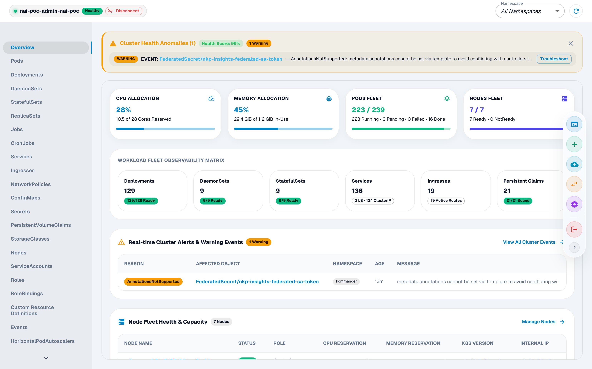
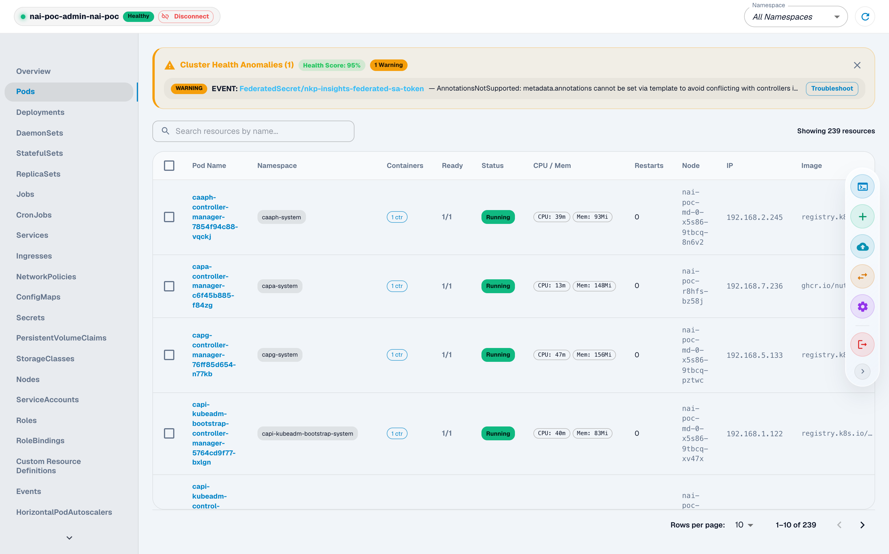
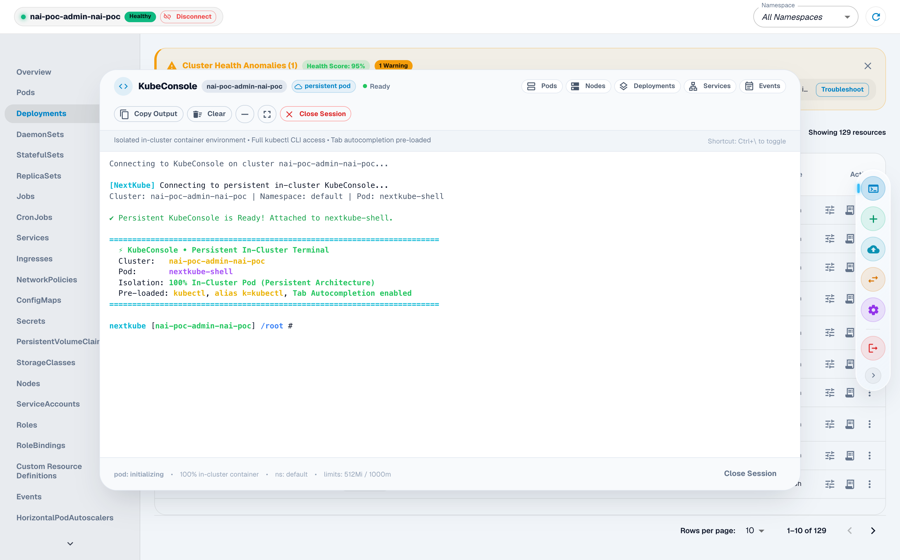
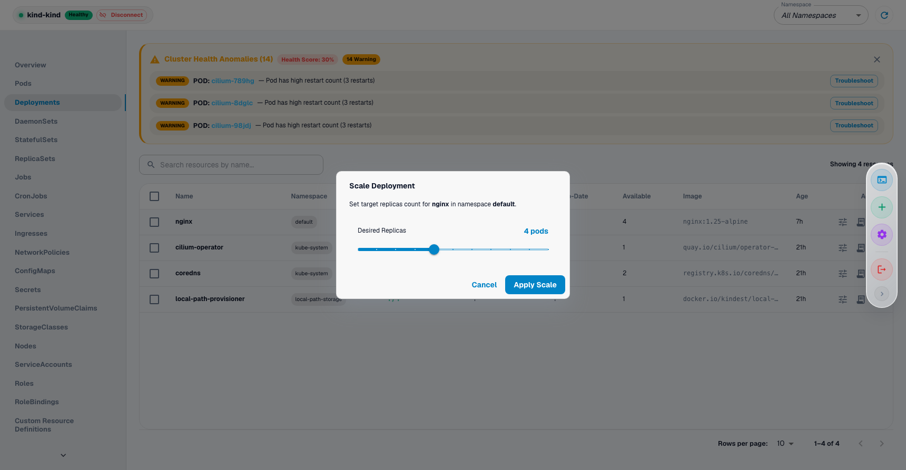
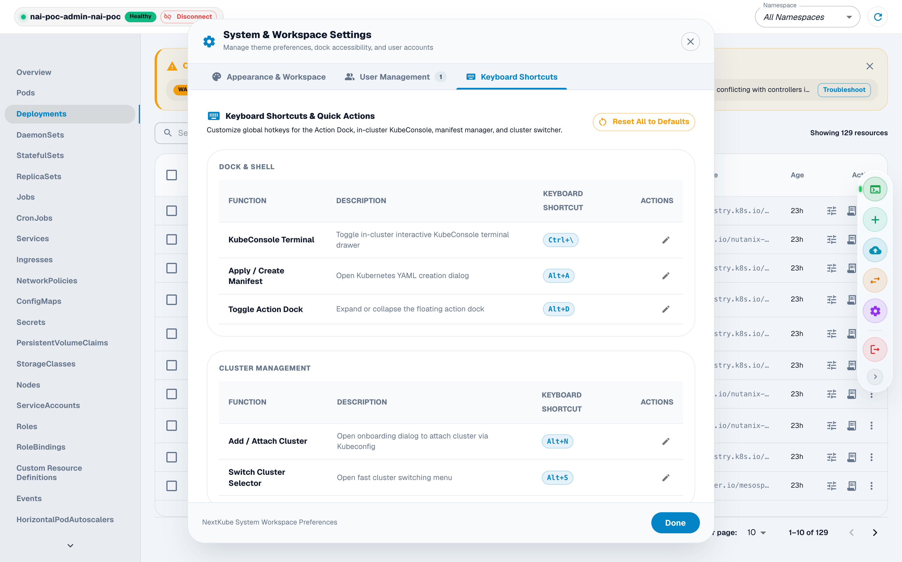
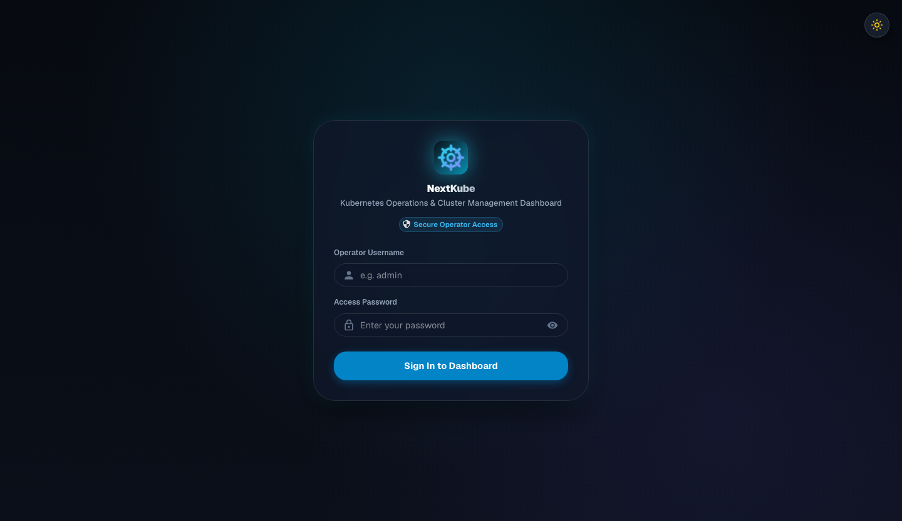

# NextKube Features & Operations Guide

NextKube equips operators and platform teams with a modern dashboard that replaces confusing CLI incantations with intuitive, visual cluster management.

---

## 🌟 Visual Feature Showcase

### 1. Cluster Observability & Workload Matrix

- **Resource Allocation Gauges**: Real-time CPU and Memory allocation cards with usage percentages and dynamic progress bars.
- **Workload Fleet Health Matrix**: Interactive breakdown of Deployments, DaemonSets, StatefulSets, Services, Ingresses, and PVCs with healthy-versus-total counts.
- **Real-Time Warning Alerts & Events Stream**: Highlights warning events, affected workloads, namespaces, and timestamps.
- **Node Fleet Health & Capacity Table**: Live node status, roles, CPU/Memory reservation, Kubernetes version, and internal IPs.

---

### 2. Pod Management & Row-Level Actions

- **Inline Pod Actions**: Direct action buttons on every pod row:
  - 📜 **View Logs**: Tail real-time stdout/stderr streams.
  - 💻 **Terminal Exec**: Open a live shell into any container in the pod.
  - 🔄 **Restart Pod**: Safely delete the pod to allow its controller to respawn a clean replacement.
  - 🗑️ **Delete**: Terminate unwanted or stuck pods.
- **Resource Search & Filtering**: Instant client-side search by pod name or namespace.

---

### 3. Real-Time Pod & Workload Logs Streaming

- **Live Stream Viewer**: Tail container logs with color-coded severity levels (`ERROR`, `WARN`, `INFO`).
- **Container Switching**: Seamlessly switch between multiple containers in a pod or across deployment replicas.
- **Timeframe & Mode Filters**: Filter logs by recency (`5m`, `15m`, `30m`, `1h`, `6h`, `24h`, or previous terminated container `pre`).
- **Timezone Adjustment**: One-click toggle between Local Browser Time and raw UTC pod timestamps.
- **In-Memory Search**: Filter lines dynamically with match count indicators.

---

### 4. Interactive In-Pod Terminal (Container Exec)

- **Direct Web Terminal**: In-browser interactive shell connected via WebSocket to the container's shell (`/bin/sh`, `/bin/bash`).
- **Multi-Session Management**: Run simultaneous terminal sessions to different pods/containers with minimize, restore, and tab cycling.
- **Draggable & Resizable Window**: Freeform cursor resizing and full-screen maximization.

---

### 5. KubeConsole — Persistent In-Cluster Shell

- **Instant Cluster CLI**: Persistent in-cluster pod architecture (`nextkube-shell`) for sub-second terminal connections without provisioning delays.
- **Background Session Preservation**: Minimize the window to keep the shell session, terminal buffer, and running commands alive in the background.
- **Fast Action Toolbar**: Pre-configured query buttons for instant access to `Pods`, `Nodes`, `Deployments`, `Services`, and `Events`.
- **Pre-loaded Tooling**: Comes equipped with `kubectl`, `alias k=kubectl`, and tab auto-completion out of the box.

---

### 6. Deployments & Workload Management

- **Workload Status**: Real-time breakdown of `Ready Replicas`, `Total Replicas`, `Up-to-Date`, and `Available` counts.
- **Quick Controls**:
  - Tune replicas directly with the inline scale tool.
  - View deployment logs across all backing replica pods.
  - Trigger rolling update restarts.

---

### 7. Interactive Replica Scaling

- **Atomic Scaling**: Scale Deployments, StatefulSets, and ReplicaSets with an intuitive slider control.
- **Zero Race Conditions**: Powered by RFC 6902 JSON Patch operations targeting the Kubernetes subresource scale API.
- **Instant Live Feedback**: Automatically refetches and synchronizes the UI the moment the API server accepts the mutation.

---

### 8. In-App YAML Manifest IDE

- **Apply & Create**: Paste or edit raw Kubernetes YAML/JSON manifests directly from the browser.
- **Syntax Highlighting & Formatting**: Integrated manifest editor with syntax highlighting and line numbering.
- **Direct Cluster Mutation**: Validates manifests against the target cluster schema and applies updates safely.

---

### 9. System Preferences & Customizable Shortcuts

- **Fluid Dark / Light Modes**: Switch between deep slate dark mode and clean daylight light mode with zero hydration flash.
- **Customizable Global Hotkeys**: Rebind shortcuts for KubeConsole, manifest editor, cluster switcher, and dock actions directly from the settings panel.
- **User Management**: Admin controls for managing operator credentials and roles.
- **Liquid Glassmorphic ActionDock**: Floating action dock provides quick access to shells, cluster switcher, manifest creation, settings, and session controls.

---

### 10. Secure Authentication Portal

- **JWT Session Protection**: High-security, encrypted session tokens stored in HTTP-only cookies.
- **Role-Based Access Control**: Pre-configured operator profiles (`admin`, `operator`, `viewer`) preventing unauthorized resource destruction.
