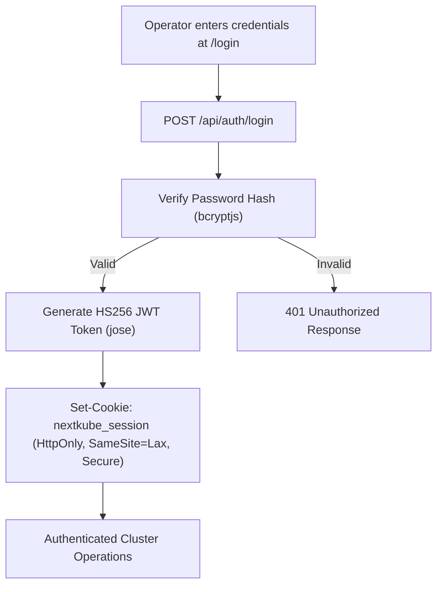

# Security, RBAC & Audit Architecture

NextKube implements enterprise-grade security protocols to protect access to Kubernetes control planes, encrypt credentials at rest, and maintain transparent audit trails.

---

## 🔐 Authentication & Session Flow

### 1. HTTP-Only Encrypted Sessions
- Authentication cookies (`nextkube_session`) are marked `HttpOnly` and `SameSite=Lax`, preventing client-side JavaScript access and cross-site scripting (XSS) session theft.
- Tokens expire automatically after 12 hours.

---

## 🛡️ Cluster Vault & Credential Encryption

Kubernetes `kubeconfig` payloads and service account tokens stored in `.nextkube/clusters.json` are encrypted using **AES-256-GCM** (Galois/Counter Mode):
- **Authenticated Encryption**: Ensures confidentiality and cryptographic integrity verification via authentication tags (`authTag`).
- **Initialization Vectors (IV)**: A distinct cryptographically random 12-byte IV is generated per cluster encryption.
- **Key Derivation**: Vault encryption keys are derived using SHA-256 digests over `NEXTKUBE_ENCRYPTION_KEY`.

---

## 👥 Role-Based Access Control (RBAC)

NextKube defines three operator tiers:

| Role | Permissions | Use Case |
|---|---|---|
| **`admin`** | Full cluster read & write, scale replicas, rollout restart, manifest apply, delete resources, user administration. | Platform Engineers, SRE Lead |
| **`operator`** | Read all resources, scale workloads, restart pods, exec into pods, view logs. Cannot delete namespaces or manage users. | Application Developers, DevOps |
| **`viewer`** | Read-only inspection of workloads, pods, nodes, events, and metrics. Terminal exec and mutations disabled. | Support, Auditors |

---

## 📜 Audit Logging

Every mutation dispatched through NextKube is captured by the audit engine in [src/server/audit.ts](file:///Users/mangale/Downloads/github/NextKube/src/server/audit.ts):
- **Tracked Operations**:
  - `SCALE_REPLICAS`: Target deployment, old vs. new replica count, operator identity.
  - `ROLLOUT_RESTART`: Triggering deployment rollout update.
  - `CUSTOM_OPERATION`: Pod deletion / restarts.
  - `APPLY_MANIFEST`: Applied manifest kind, name, namespace.
  - `DELETE_RESOURCE`: Target resource type, name, namespace.
- **Audit Attributes Recorded**:
  - `timestamp`: UTC ISO 8601 timestamp.
  - `user`: Operator username from verified JWT.
  - `clusterId`: Unique identifier of targeted cluster.
  - `status`: `SUCCESS` or `FAILED` (with error message from Kubernetes API if failed).
